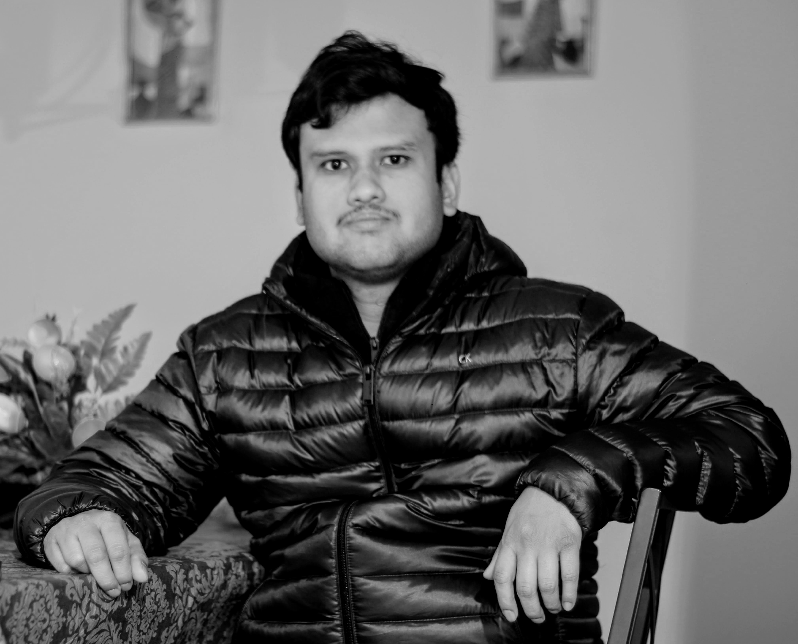

# Dipayan Chattopadhyay

Software Development Manager at Amazon Web Services

Building scalable distributed systems and leading high-performing engineering teams

  <a href="https://www.linkedin.com/in/dchattopadhyay" class="md-button md-button--primary" target="_blank" rel="noopener">LinkedIn</a>
  <a href="#quick-links" class="md-button">Explore Portfolio</a>

  

## About Me

Software engineering leader with over 10 years of experience building complex distributed systems in enterprise environments. Since September 2023 I have managed an organization of 20 engineers across 4 pods at AWS, delivering mission-critical customer experience features for Amazon Connect used by thousands of enterprises globally.

My expertise includes:

* **Leadership**: Leading technical teams through complex projects from design to delivery
* **Architecture**: Designing resilient, scalable distributed systems
* **Engineering**: Building enterprise-grade solutions with modern tech stacks
* **Cloud**: Extensive experience with AWS services and cloud architecture

## Experience
* Software Development Manager at AWS (since September 2023)
* Former Engineer at Nordstrom, CDK Global
* Over 10 years in distributed systems
* [Learn more →](experience.md)

## Skills & Expertise
* Java, Python, JavaScript, Scala
* AWS Services
* Distributed Systems
* Big Data Processing
* [View all skills →](skills.md)

## Open Source Projects
* Spring Actuator CloudWatch, Deep Learning Image Similarity, Autoerroretry
* Contributed to Nordstrom Big-data Profiler
* Passionate about sharing knowledge
* [See projects →](opensource.md)

## Personal
* IEEE Member
* Multilingual (6 languages)
* Sports enthusiast
* [More about me →](miscellaneous.md)

---

*Last reviewed: 2026-10*
